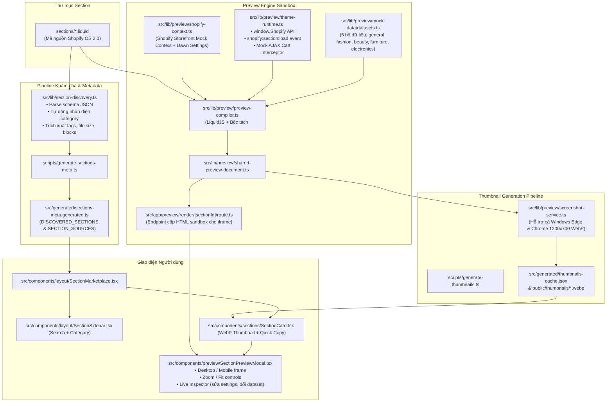

# 🧭 TÀI LIỆU TOÀN DIỆN DỰ ÁN: SHOPIFY CUSTOM SECTIONS LIBRARY

> **Dành cho AI Agent & Developer:** Đọc tài liệu này để nắm bắt 100% kiến trúc, luồng hoạt động, cấu trúc mã nguồn, trạng thái hiện tại và lộ trình phát triển tiếp theo của dự án. Không cần đọc quét lại toàn bộ file nếu không cần thiết.

---

## 1. TỔNG QUAN DỰ ÁN (PROJECT OVERVIEW)

- **Tên dự án:** `sections-shopify` (Shopify Custom Sections Library - Online Store 2.0).
- **Mục tiêu:** Xây dựng một thư viện / marketplace hiển thị các section Shopify tùy biến chuyên nghiệp, cho phép nhà phát triển và chủ shop xem trước (Live Preview) tương tác trực tiếp, tùy chỉnh dữ liệu mẫu, chụp thumbnail thực tế, và sao chép mã Liquid sạch sẽ chỉ với **1 cú click**.
- **Phong cách thiết kế:** Tinh gọn, hiện đại, lấy cảm hứng từ Shopify Marketplace UI.
  - Tông màu: Nền xám `#F5F5F5`, card trắng viền `#E5E5E5`, bo góc `12px`, typography sắc nét.
  - Bố cục: 2 cột (Sidebar bộ lọc cố định bên trái 280-300px + Grid hiển thị section 3 cột bên phải).
  - Tối ưu Mobile / Tablet với Drawer lọc trượt mượt mà.

---

## 2. STACK CÔNG NGHỆ (TECH STACK)

| Thành phần | Công nghệ / Thư viện | Phiên bản | Vai trò & Đặc điểm |
|---|---|---|---|
| **Core Framework** | Next.js (App Router, Turbopack) | `16.4.3` | Server Component, API Routes, Static pre-rendering |
| **Giao diện** | React | `19.3.0` | UI component tree, hooks, client-side state |
| **Styling** | Tailwind CSS v4 (`@tailwindcss/turbopack`) | `^4` | Atomic CSS tốc độ cao qua `@import "tailwindcss";` |
| **Liquid Engine** | LiquidJS (`liquidjs`) | `^10.30.1` | Biên dịch template Liquid thành HTML độc lập |
| **Icons** | Lucide React (`lucide-react`) | `^1.64.0` | Bộ icon SVG nhẹ nhàng, đồng nhất |
| **Sanitizer** | isomorphic-dompurify | `^3.19.0` | Xử lý an toàn HTML/CSS chèn vào Preview |
| **Screenshots** | Playwright Core (`playwright-core`) | `^1.64.1` | Headless Chromium (Edge/Chrome) chụp ảnh section thành WebP |
| **Scripts Runner** | `tsx` & TypeScript | `5.x` | Chạy TypeScript script trực tiếp không cần compile |

---

## 3. SƠ ĐỒ KIẾN TRÚC & DỮ LIỆU (SYSTEM ARCHITECTURE)



---

## 4. CẤU TRÚC THƯ MỤC CHI TIẾT (DIRECTORY STRUCTURE)

```text
sections-shopify/
├── sections/                         # 🌟 Thư mục chứa các file mã nguồn Liquid gốc
│   ├── faq-contact-v1.liquid          # Section FAQ Accordion kết hợp form liên hệ (~628 dòng)
│   ├── feature-products-v1.liquid     # Section sản phẩm nổi bật đa tính năng (~2,294 dòng)
│   ├── hero-v1.liquid                 # Section Hero Banner responsive (~1,130 dòng)
│   └── newsletter-join-v1.liquid      # Section Newsletter Botanical / Minimal (~870 dòng)
├── public/
│   └── thumbnails/                    # Ảnh chụp màn hình WebP kích thước 1200x700
│       ├── faq-contact-v1.webp
│       ├── feature-products-v1.webp
│       ├── hero-v1.webp
│       └── newsletter-join-v1.webp
├── scripts/
│   ├── generate-sections-meta.ts      # Script tự động quét sections/ -> gen metadata TypeScript
│   └── generate-thumbnails.ts         # Script dùng Playwright chụp ảnh render WebP vào public/thumbnails/
├── src/
│   ├── app/                           # Next.js App Router
│   ├── components/                    # Header, Sidebar, Grid, Card, Modal, Preview Canvas & Inspector
│   ├── generated/
│   │   ├── sections-meta.generated.ts # ⚠️ AUTO-GENERATED: File chứa mảng metadata và source code
│   │   └── thumbnails-cache.json      # Cache hash kiểm tra thay đổi file
│   └── lib/
│       ├── section-discovery.ts       # Thuật toán phân tích Liquid, parse schema, phân loại category
│       └── preview/                   # Preview compiler, mock context, filters, tags, runtime
```

---

## 5. MÔI TRƯỜNG GIẢ LẬP SHOPIFY THEME CHUẨN (SIMULATION ENVIRONMENT)

Hệ thống giả lập môi trường Shopify Theme được thiết kế đồng bộ từ Server (LiquidJS) đến Client (Iframe Sandbox):

### 5.1. Bộ Tag & Filter Shopify Toàn Diện
- **Liquid Tags:**
  - ``: Tự động sinh input ẩn chuẩn Shopify (`form_type`, `utf8`, `id`) và context `form`.
  - `...` & `...`: Bóc tách và thực thi an toàn trong sandbox.
  - ``: Cung cấp đối tượng `paginate` đầy đủ (`current_page`, `pages`, `page_size`, `parts`).
  - `` & ``: Snippet registry dựng sẵn (`price`, `icon`, `badge`, `product-card`, `social-icons`, `pagination`).
- **Liquid Filters:**
  - Hình ảnh: `image_url` (hỗ trợ `width`, `height`, `crop`), `img_url` (hỗ trợ `master`, `600x`, `crop`), `image_tag` (tạo thẻ `` kèm srcset, lazy loading), `placeholder_svg_tag`.
  - Phông chữ & Typography: `font_face` (sinh `@font-face` và nạp Google Fonts `@import url(...)`), `font_modify` (biến đổi `weight` hoặc `style`).
  - Tiền tệ: `money`, `money_with_currency`, `money_without_trailing_zeros`, `money_without_currency`.
  - Màu sắc: `color_to_rgb`, `color_to_hex`, `color_to_hsl`, `color_modify` (ví dụ `alpha: 0.8`), `color_lighten`, `color_darken`, `color_mix`, `color_extract`.
  - Ngôn ngữ: `t` (tự động mapping từ điển chuẩn của Dawn và fallback thông minh).
  - Khác: `json`, `weight_with_unit`, `highlight`, `link_to`, `link_to_vendor`, `link_to_type`, `link_to_tag`, `within`.

### 5.2. Đối Tượng Ngữ Cảnh Storefront (Context Objects)
- `section`: Gồm `id`, `index: 1`, `settings` (đầy đủ default từ schema; các setting `font_picker` tự động phân giải thành Shopify Font Drop có `.family` và `.fallback_families`), `blocks` (kèm `shopify_attributes` chuẩn editor).
- `request`: `design_mode: true` (kích hoạt các logic theme editor), `page_type: 'index'`, `host`, `locale`.
- `theme`: `name: 'Dawn (Shopify OS 2.0)'`, `id: 98765432`, `role: 'main'`.
- `settings`: Cung cấp các biến global theme Dawn (`page_width: 1200`, `currency_code_enabled`, `sale_badge_color_scheme`, `badge_position`, `card_style`).
- `customer`: Đối tượng khách hàng mẫu (`first_name`, `email`, `orders_count`, `default_address`).
- `cart`: Giỏ hàng mẫu 2 sản phẩm kèm giá, số lượng.
- `routes`: Bộ URL chuẩn (`root_url`, `cart_url`, `cart_add_url`, `search_url`, `all_products_collection_url`, v.v.).

---

## 6. DANH SÁCH SECTION HIỆN CÓ & TÌNH TRẠNG (INVENTORY)

| # | ID / Tên File | Tiêu đề hiển thị | Danh mục | Preset Name | Số dòng | Số settings |
|---|---|---|---|---|---|---|
| 1 | `faq-contact-v1.liquid` | Custom FAQ | `faq` | Custom FAQ | 628 | 15+ |
| 2 | `feature-products-v1.liquid` | Custom Featured Products | `features` | Custom Featured Products | 2,294 | 40+ |
| 3 | `hero-v1.liquid` | Section Hero | `hero` | Section Hero | 1,130 | 15+ |
| 4 | `newsletter-join-v1.liquid` | Newsletter Join | `product` | Botanical Newsletter | 870 | 25+ |

---

## 7. CÁC LỆNH DỰ ÁN QUAN TRỌNG (SCRIPTS)

```bash
# 1. Cài đặt các gói phụ thuộc
npm install

# 2. Sinh metadata cho toàn bộ section trong sections/
npm run sections:generate

# 3. Sinh ảnh thumbnail WebP bằng Playwright (hỗ trợ cả Windows Edge & Chrome)
npm run thumbnails:generate

# 4. Chạy môi trường phát triển (Hot reload)
npm run dev

# 5. Kiểm tra cú pháp và kiểu (Linting)
npm run lint

# 6. Build dự án sản xuất (Production static export)
npm run build
npm run start
```
