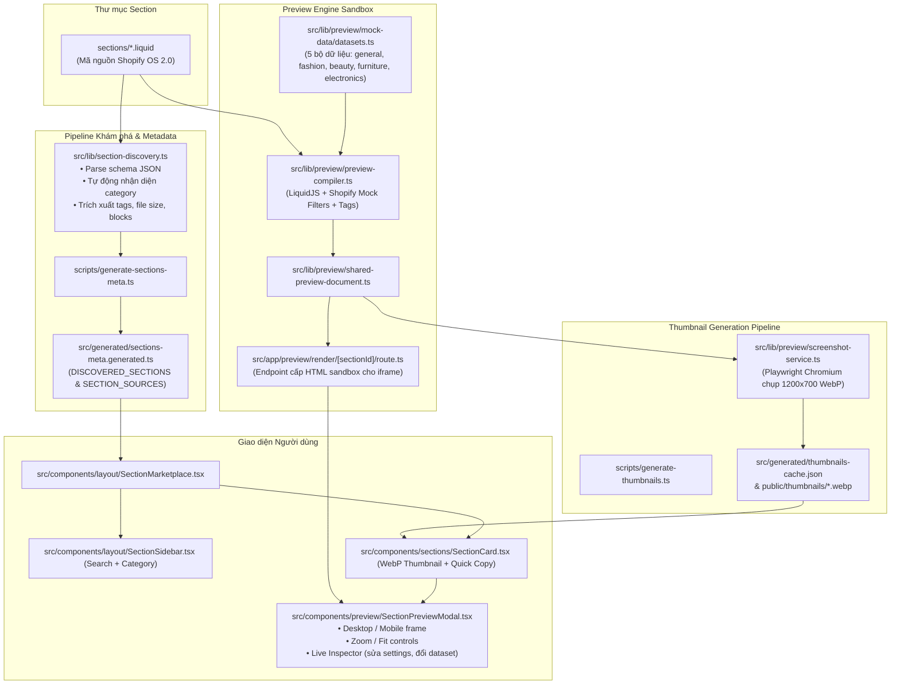

# 🧭 TÀI LIỆU TOÀN DIỆN DỰ ÁN: SHOPIFY CUSTOM SECTIONS LIBRARY

> **Dành cho AI Agent & Developer:** Đọc tài liệu này để nắm bắt 100% kiến trúc, luồng hoạt động, cấu trúc mã nguồn, trạng thái hiện tại và lộ trình phát triển tiếp theo của dự án. Không cần đọc quét lại toàn bộ file nếu không cần thiết.

---

## 1. TỔNG QUAN DỰ ÁN (PROJECT OVERVIEW)

- **Tên dự án:** `sections-shopify` (Shopify Custom Sections Library - Online Store 2.0).
- **Mục tiêu:** Xây dựng một thư viện / marketplace hiển thị các section Shopify tùy biến chuyên nghiệp, cho phép nhà phát triển và chủ shop xem trước (Live Preview) tương tác trực tiếp, tùy chỉnh dữ liệu mẫu, chụp thumbnail thực tế, và sao chép mã Liquid sạch sẽ chỉ với **1 cú click**.
- **Phong cách thiết kế:** Tinh gọn, hiện đại, lấy cảm hứng từ Shopify Marketplace UI.
  - Tông màu: Nền xám `#F5F5F5`, card trắng viền `#E5E5E5`, bo góc `12px`, typography sắc nét.
  - Bố cục: 2 cột (Sidebar bộ lọc cố định bên trái 280-300px + Grid hiển thị section 3 cột bên phải).
  - Tối ưu Mobile / Tablet với Drawer lọc trượt mượt mà.

---

## 2. STACK CÔNG NGHỆ (TECH STACK)

| Thành phần         | Công nghệ / Thư viện                       | Phiên bản  | Vai trò & Đặc điểm                                 |
| ------------------ | ------------------------------------------ | ---------- | -------------------------------------------------- |
| **Core Framework** | Next.js (App Router, Turbopack)            | `16.4.3`   | Server Component, API Routes, Static pre-rendering |
| **Giao diện**      | React                                      | `19.3.0`   | UI component tree, hooks, client-side state        |
| **Styling**        | Tailwind CSS v4 (`@tailwindcss/turbopack`) | `^4`       | Atomic CSS tốc độ cao qua `@import "tailwindcss";` |
| **Liquid Engine**  | LiquidJS (`liquidjs`)                      | `^10.30.1` | Biên dịch template Liquid thành HTML độc lập       |
| **Icons**          | Lucide React (`lucide-react`)              | `^1.64.0`  | Bộ icon SVG nhẹ nhàng, đồng nhất                   |
| **Sanitizer**      | isomorphic-dompurify                       | `^3.19.0`  | Xử lý an toàn HTML/CSS chèn vào Preview            |
| **Screenshots**    | Playwright Core (`playwright-core`)        | `^1.64.1`  | Headless Chromium chụp ảnh section thành WebP      |
| **Scripts Runner** | `tsx` & TypeScript                         | `5.x`      | Chạy TypeScript script trực tiếp không cần compile |

---

## 3. SƠ ĐỒ KIẾN TRÚC & DỮ LIỆU (SYSTEM ARCHITECTURE)



---

## 4. CẤU TRÚC THƯ MỤC CHI TIẾT (DIRECTORY STRUCTURE)

```text
sections-shopify/
├── sections/                         # 🌟 Thư mục chứa các file mã nguồn Liquid gốc
│   ├── custom-feature-products.liquid # Section sản phẩm nổi bật đa tính năng (~2,294 dòng)
│   ├── faq-contact.liquid             # Section FAQ Accordion kết hợp form liên hệ (~628 dòng)
│   └── hero.liquid                    # Section Hero Banner responsive (~1,130 dòng)
├── public/
│   └── thumbnails/                    # Ảnh chụp màn hình WebP kích thước 1200x700
│       ├── custom-feature-products.webp
│       ├── faq-contact.webp
│       └── hero.webp
├── scripts/
│   ├── generate-sections-meta.ts      # Script tự động quét sections/ -> gen metadata TypeScript
│   └── generate-thumbnails.ts         # Script dùng Playwright chụp ảnh render WebP vào public/thumbnails/
├── src/
│   ├── app/                           # Next.js App Router
│   │   ├── globals.css                # Tailwind CSS v4 styling
│   │   ├── layout.tsx                 # Root layout, fonts, title
│   │   ├── page.tsx                   # Server Component trang chủ, gọi getAllSections()
│   │   ├── api/
│   │   │   ├── sections/[id]/route.ts # API trả về mã nguồn Liquid của 1 section (hỗ trợ hot-reload ở dev)
│   │   │   └── thumbnails/[sectionId]/route.ts # API kích hoạt chụp lại WebP thumbnail
│   │   └── preview/
│   │       └── render/[sectionId]/route.ts # Endpoint trả về standalone HTML để nhúng vào iframe
│   ├── components/
│   │   ├── layout/
│   │   │   ├── AppHeader.tsx          # Thanh header trên cùng (Logo, số section, link GitHub, nút mobile filter)
│   │   │   ├── SectionSidebar.tsx     # Sidebar lọc (Search, Radio Category kèm đếm số lượng động)
│   │   │   ├── MobileFilterDrawer.tsx # Drawer trượt bộ lọc trên Mobile
│   │   │   └── SectionMarketplace.tsx # Container chính điều phối state: search, filter, preview modal
│   │   ├── preview/
│   │   │   ├── SectionPreviewModal.tsx# Modal bao bọc cửa sổ xem trước
│   │   │   ├── PreviewWorkspace.tsx   # Workspace chứa canvas + thanh toolbar + inspector
│   │   │   ├── PreviewToolbar.tsx     # Công cụ: đổi Desktop/Mobile, Zoom in/out, Fit to view, Refresh
│   │   │   ├── PreviewCanvas.tsx      # Canvas chứa iframe hiển thị section
│   │   │   ├── DeviceFrame.tsx        # Khung viền mô phỏng màn hình Desktop và Mobile (375px/390px/430px)
│   │   │   ├── PreviewInspector.tsx   # Panel trượt bên phải: chỉnh settings live, chọn dataset mock, xem diagnostic
│   │   │   └── PreviewStatus.tsx      # Huy hiệu trạng thái: compiling, ready, error
│   │   ├── sections/
│   │   │   ├── SectionCard.tsx        # Thẻ card hiển thị section: ảnh WebP, icon danh mục, 1-Click Copy Code, nút Preview
│   │   │   └── SectionGrid.tsx        # Lưới hiển thị các thẻ SectionCard
│   │   └── ui/
│   │       └── Toast.tsx              # Toast thông báo "Liquid code copied!"
│   ├── data/
│   │   ├── categories.ts              # Định nghĩa 7 danh mục (all, hero, features, product, social-proof, faq, header, uncategorized)
│   │   ├── sections-meta.ts           # Re-export metadata từ file generated
│   │   └── preview/                   # Dữ liệu tĩnh phụ trợ (collections, products, settings, shop)
│   ├── generated/
│   │   ├── sections-meta.generated.ts # ⚠️ AUTO-GENERATED: File chứa mảng metadata và source code của toàn bộ sections
│   │   └── thumbnails-cache.json      # Cache hash kiểm tra thay đổi file để tránh chụp lại screenshot không cần thiết
│   └── lib/
│       ├── sections.ts                # Client/server helper đọc sections (dev: dynamic hot read, prod: dùng generated bundle)
│       ├── section-discovery.ts       # Thuật toán phân tích Liquid, parse schema, phân loại category theo từ khóa
│       ├── section-client.ts          # Client-side cache và fetch mã nguồn Liquid qua API
│       └── preview/
│           ├── shared-preview-document.ts # Cầu nối thống nhất giữa Iframe Preview và Screenshot Generator
│           ├── preview-compiler.ts    # Bộ máy biên dịch LiquidJS bọc mã trong HTML document an toàn
│           ├── liquid-engine.ts       # Cấu hình LiquidJS engine
│           ├── liquid-filters.ts      # Filter đặc thù Shopify (image_url, image_tag, money, placeholder_svg_tag, t, ...)
│           ├── liquid-tags.ts         # Tag đặc thù Shopify (, ...)
│           ├── liquid-schema.ts       # Trích xuất và bóc tách schema JSON
│           ├── schema-engine.ts       # Tạo settings mặc định từ schema
│           ├── shopify-context.ts     # Mock Storefront Context (section, blocks, product, cart, shop, ...)
│           ├── theme-runtime.ts       # CSS reset cơ bản mô phỏng Dawn/Shopify theme
│           ├── screenshot-service.ts  # Service khởi chạy Playwright headless browser
│           ├── thumbnail-cache.ts     # Quản lý hash và tính hợp lệ của thumbnail WebP
│           ├── use-active-preview.ts  # React Hook quản lý trạng thái modal preview
│           ├── mock-data/             # 5 datasets sản phẩm mock chất lượng cao
│           └── snippets/              # Registry cho các snippet thông dụng (, 'icon', ...)
├── package.json
├── tsconfig.json
├── next.config.ts
├── DOCUMENTATION.md                   # Tài liệu chi tiết kỹ thuật từ phiên bản trước
└── README.md                          # Giới thiệu cơ bản dự án
```

---

## 5. CÁC CƠ CHẾ CỐT LÕI (CORE MECHANISMS)

### 5.1. Live Preview Sandbox (LiquidJS)

- **Không dùng ảnh tĩnh giả lập:** Người dùng tương tác trực tiếp với giao diện thật được render từ chính file `.liquid`.
- **Tách Schema:** Khối `...` được bóc tách bằng regex. Phần JSON schema được parse để trích xuất `presets` và giá trị `default` của từng setting.
- **Mock Shopify Environment:** Engine cấp sẵn các đối tượng toàn cục mà Liquid trong theme Shopify thường dùng:
  - `section.id`, `section.settings`, `section.blocks`
  - `product`, `products`, `collection`, `collections`
  - `cart`, `shop`, `routes`, `request`, `localization`, `form`
- **Isolation bằng Iframe:** Giao diện rendered được đưa vào `<iframe>` qua `srcDoc` hoặc `/preview/render/[sectionId]`. Điều này đảm bảo CSS/JS của section không bao giờ xung đột với Tailwind CSS của website chính.
- **Theme Foundation CSS:** Tự động chèn CSS reset của theme Shopify chuẩn (`--font-body-family`, `--page-width: 1440px`, typography chuẩn) và can thiệp chặn các link/submit không mong muốn.

### 5.2. Automated Thumbnail Generation (Playwright WebP)

- File ảnh chụp màn hình được lưu tại `public/thumbnails/{sectionId}.webp`.
- **Độ phân giải:** Viewport 1200x700, format WebP chất lượng 85%.
- **Cơ chế Hash Cache (`thumbnails-cache.json`):** Mỗi khi chạy script, hệ thống tính toán hash của mã nguồn Liquid + mã nguồn preview engine. Nếu không có thay đổi, hệ thống bỏ qua không chụp lại, giúp tiết kiệm tối đa thời gian build.

### 5.3. Trải nghiệm 1-Click Copy Code

- Ở cả **Section Card** ngoài trang chủ và trên thanh **Preview Toolbar** trong Modal đều có nút Copy Code.
- Client gọi hàm `fetchSectionCode(id)`: tự động lấy code từ bộ nhớ in-memory cache hoặc từ `/api/sections/[id]`, sau đó đưa thẳng vào `navigator.clipboard.writeText(code)`.
- Kèm hiệu ứng Toast phản hồi tức thì: _"Liquid code copied! (Tên section)"_.

---

## 6. DANH SÁCH SECTION HIỆN CÓ & TÌNH TRẠNG (INVENTORY)

Hiện tại trong thư mục `sections/` gồm 3 section chất lượng cao:

| #   | ID / Tên File                    | Tiêu đề hiển thị        | Danh mục  | Preset Name              | Số dòng | Số settings |
| --- | -------------------------------- | ----------------------- | --------- | ------------------------ | ------- | ----------- |
| 1   | `hero.liquid`                    | Custom Hero             | `hero`    | Custom Hero              | 1,130   | 15+         |
| 2   | `faq-contact.liquid`             | Custom FAQ & Contact    | `faq`     | Custom FAQ               | 628     | 15+         |
| 3   | `custom-feature-products.liquid` | Custom Feature Products | `product` | Custom Featured Products | 2,294   | 40+         |

> **Lưu ý về Git History:**
>
> - Trước commit `4a5b240`, thư viện từng có 11 section mẫu cơ bản. Sau đó tác giả đã refactor tinh gọn để thay thế bằng các section chuyên sâu, chi tiết hơn (như `custom-feature-products.liquid`).
> - Có 1 file thừa ở root: `custom-hero.liquid` (trùng mã băm SHA256 với `sections/hero.liquid`).

---

## 7. CẨM NANG DÀNH CHO AI AGENT: CÁC QUY TRÌNH THỰC HIỆN

### 7.1. Khi được yêu cầu: "Thêm một Section mới"

Thực hiện đầy đủ 4 bước sau:

1. **Tạo file `.liquid` trong thư mục `sections/`:**
   - Ví dụ: `sections/custom-testimonials.liquid`.
   - **Bắt buộc:** Phải có khối `...` hợp lệ ở cuối file.
   - **Bắt buộc:** Trong `schema`, phải có trường `presets` với ít nhất 1 preset name và các `default` block (nếu section dùng block).
   - Tên class và CSS phải được scope cẩn thận (ví dụ sử dụng `section-{{ section.id }}` hoặc prefix riêng) để không vỡ giao diện.
2. **Cập nhật Metadata:**
   - Chạy lệnh: `npm run sections:generate` (hoặc `npx tsx scripts/generate-sections-meta.ts`).
   - Script sẽ tự động nhận diện danh mục (`hero`, `features`, `product`, `social-proof`, `faq`, `header`), đếm dòng, tính dung lượng file và cập nhật vào `src/generated/sections-meta.generated.ts`.
3. **Tạo Thumbnail WebP:**
   - Chạy lệnh: `npm run thumbnails:generate` (hoặc mở Preview Modal của section đó và bấm nút camera trong Inspector để kích hoạt API `/api/thumbnails/[sectionId]`).
   - File thumbnail sẽ tự động được sinh ra tại `public/thumbnails/{id}.webp`.
4. **Kiểm tra chất lượng:**
   - Đảm bảo `npm run lint` hoặc `npm run build` không phát sinh lỗi TypeScript hay ESLint.

### 7.2. Khi được yêu cầu: "Chỉnh sửa hoặc nâng cấp một Section"

1. Đọc và chỉnh sửa trực tiếp file trong `sections/<name>.liquid`.
2. Kiểm tra schema JSON xem có bị lỗi cú pháp không (dấu phẩy thừa, thiếu ngoặc nhọn).
3. Chạy `npm run sections:generate` để đồng bộ lại source code nhúng vào file metadata bundle.
4. Nếu có thay đổi lớn về layout hiển thị, chạy `npx tsx scripts/generate-thumbnails.ts --force` để cập nhật lại ảnh preview.

### 7.3. Khi được yêu cầu: "Hỗ trợ thêm cú pháp Liquid mới"

- Nếu section cần filter mới của Shopify chưa được hỗ trợ (ví dụ: `weight_with_unit`, `color_to_rgb`, `link_to`):
  -> Thêm hàm xử lý vào [`src/lib/preview/liquid-filters.ts`](file:///d:/works/sections-shopify/src/lib/preview/liquid-filters.ts).
- Nếu section cần tag mới (ví dụ: ``):
  -> Thêm vào [`src/lib/preview/liquid-tags.ts`](file:///d:/works/sections-shopify/src/lib/preview/liquid-tags.ts).
- Nếu section gọi snippet qua ``:
  -> Khai báo template giả lập vào [`src/lib/preview/snippets/snippet-registry.ts`](file:///d:/works/sections-shopify/src/lib/preview/snippets/snippet-registry.ts).

---

## 8. CÁC LỆNH DỰ ÁN QUAN TRỌNG (SCRIPTS)

```bash
# 1. Cài đặt các gói phụ thuộc (nếu chưa có node_modules)
npm install

# 2. Sinh metadata cho toàn bộ section trong sections/
npm run sections:generate
# hoặc: npx tsx scripts/generate-sections-meta.ts

# 3. Sinh ảnh thumbnail WebP bằng Playwright
npm run thumbnails:generate
# hoặc ép buộc chụp lại tất cả: npx tsx scripts/generate-thumbnails.ts --force

# 4. Chạy môi trường phát triển (Hot reload)
npm run dev

# 5. Kiểm tra cú pháp và kiểu (Linting)
npm run lint

# 6. Build dự án sản xuất (Production static export)
npm run build
npm run start
```

---

## 9. CÁC YÊU CẦU & KẾ HOẠCH PHÁT TRIỂN TIẾP THEO (NEXT ROADMAP)

Dưới đây là danh sách các tính năng và nhiệm vụ kỹ thuật đã được vạch ra để tiếp tục mở rộng dự án:

### Giai đoạn 1: Bổ sung Section vào các Danh mục đang trống (High Priority)

Sau đợt refactor, hiện tại danh mục `features`, `social-proof`, và `header` đang có 0 item. Cần xây dựng và bổ sung các section chuyên nghiệp:

1. **Social Proof & Reviews:**
   - Section đánh giá khách hàng dạng Carousel / Masonry Grid (`customer-reviews-masonry.liquid`).
   - Dải Logo báo chí & đối tác chạy vô tận (`brand-logo-marquee.liquid`).
   - Thanh đếm số lượng người mua thời gian thực (`live-visitors-counter.liquid`).
2. **Features & Bento Grid:**
   - Bento Grid phong cách Apple / Linear (`apple-bento-grid.liquid`).
   - Bảng so sánh tính năng sản phẩm trước và sau (`before-after-slider.liquid` hoặc `comparison-table.liquid`).
3. **Announcement & Header:**
   - Thanh thông báo chạy chữ vô tận đa thông điệp (`marquee-announcement-bar.liquid`).
   - Countdown Flash Sale Banner có đồng hồ đếm ngược (`flash-sale-countdown.liquid`).
4. **Product & Conversion Boosters:**
   - Thanh mua hàng nổi dính đáy màn hình (`sticky-add-to-cart-bar.liquid`).
   - Bundle & Save (Mua kèm combo giảm giá) (`product-bundle-builder.liquid`).

### Giai đoạn 2: Nâng cấp Trải nghiệm Preview & Customizer (Medium Priority)

1. **Export Customized Liquid:**
   - Trong `PreviewInspector`, khi người dùng chỉnh sửa các thanh trượt màu sắc, typography, padding -> Cho phép người dùng bấm nút **"Download with Custom Settings"** hoặc **"Copy Preset JSON"** để xuất file Liquid với các giá trị người dùng vừa chỉnh được điền sẵn vào preset mặc định.
2. **Dark / Light Mode Preview:**
   - Thêm nút chuyển đổi nền xem trước (White / Neutral / Dark Storefront) trong thanh `PreviewToolbar` để kiểm tra độ tương phản màu chữ của section trên nền tối.
3. **Viewport Ruler & Custom Resize:**
   - Bổ sung thanh kéo thả chiều rộng tùy ý (Responsive Drag Handle) bên cạnh các nút preset cố định (375px, 1200px, 1440px).

### Giai đoạn 3: Dọn dẹp & Tối ưu Hệ thống (Maintenance)

1. **Dọn file rác:**
   - Xóa file `custom-hero.liquid` ở thư mục gốc vì đã có `sections/hero.liquid`.
2. **Commit và đẩy uncommitted changes:**
   - Commit thay đổi trong `sections/custom-feature-products.liquid` (`header_alignment: "left"`).
3. **Tự động hóa CI/CD:**
   - Cấu hình GitHub Actions tự động chạy `npm run sections:generate` mỗi khi có PR hoặc push vào nhánh `main`.

---

## 10. GHI CHÚ QUAN TRỌNG DÀNH CHO AI AGENT

- Khi được hỏi về thông tin dự án, **hãy tham chiếu trực tiếp các cấu trúc và quy trình trong tài liệu này**.
- **Không tự ý sửa khối chú thích của Next.js trong `AGENTS.md`** (đã được quy định trong quy tắc hệ thống).
- Khi tạo thêm bất kỳ section nào, hãy luôn tuân thủ nguyên tắc: **Độc lập, không phụ thuộc app ngoài, CSS scoped sạch sẽ, Liquid OS 2.0 schema chuẩn xác**.
